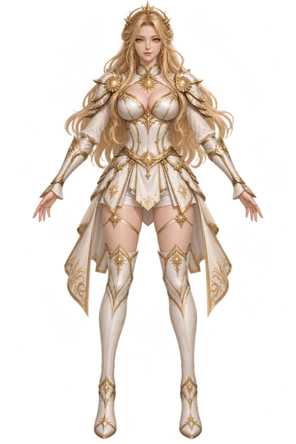
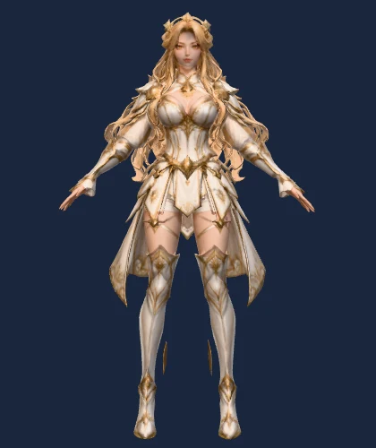
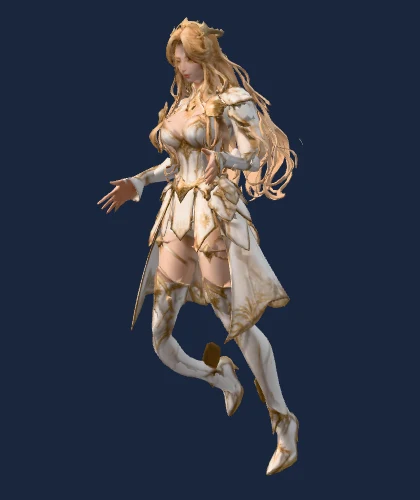
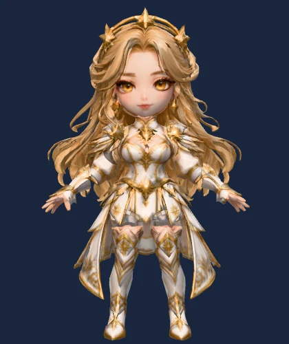
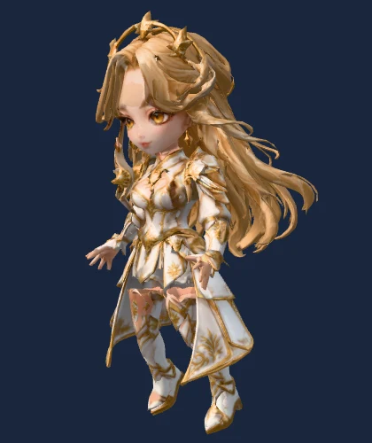

# WJH 3D Lab

**Test image-to-3D models. Compare the output. Keep the evidence.**

An independent workshop for TRELLIS.1, TRELLIS.2 and Hunyuan3D 2.1, reference-image correction, experimental texture transfer, fitted character rigs, static assets and visual QA. No game server required.

[한국어 사용법](docs/QUICKSTART.ko.md) · [Visual gallery](https://woopo666.github.io/wjh-3d-lab/) · [Provider setup](docs/PROVIDERS.md) · [Taxonomy](PRODUCTION_TAXONOMY.md) · [Validation](docs/VALIDATION.md)

## Input → result

Selected **original designs** from recorded authoring jobs. These are historical illustrations, not newly generated benchmarks or promises of output quality. Rear hair, clothing and deformation can still need manual repair.

| Input reference | Corrected & rigged | Running pose |
|---|---|---|
|  |  |  |
|  |  |  |

The established hybrid is **TL2 geometry + the original 2D reference**, not a fusion of TL1/TL2 weights. The new `tl1-transfer` experiment bakes an aligned donor mesh's albedo onto unchanged target geometry/UVs. It is opt-in, not a general solution for mismatched faces.

## Capabilities

| Path | Implementation and limits |
|---|---|
| TL2 generation | GPU adapter; actual smoke-test status in validation record |
| TL1 generation | Upstream API adapter; separate CUDA runtime; not end-to-end GPU-tested in this release |
| Hunyuan3D 2.1 | Shape + paint adapter; separate CUDA runtime; not end-to-end GPU-tested in this release |
| Pixal3D / others | Import GLB only; no generation adapter |
| Reference-front | Production-derived projection; configurable 0.6% human face alignment |
| Donor transfer | Experimental closest-triangle UV bake; synthetic color/geometry/rejection tests |
| Characters | Humanoid / prone / quadruped fitted rigs; inspect anatomy and clothing |
| Static assets | Weapon / environment / prop review and export without character bones |
| Avian / serpentine | No fitted animation rig; explicitly rejected |

Numeric gates **do not certify beauty, resemblance or anatomy**. Review views and record a decision before export.

## Try without AI weights

Python 3.11+, Node.js 22+, graphics-capable browser; Blender 4.2+ for native archival/export. AI generation requires separate upstream Linux/CUDA environments.

```bash
git clone https://github.com/woopo666/wjh-3d-lab.git
cd wjh-3d-lab
python -m venv .venv
# Linux/macOS: source .venv/bin/activate
# Windows: use .venv/Scripts/python.exe in place of python below
python -m pip install -r requirements.txt
npm ci
npx playwright install chromium
python examples/make_sample.py
python pipeline.py init Calibration --reference jobs/sample-input/front.png --model jobs/sample-input/source.glb --category prop --morphology static --surface native
npm run studio
```

In a second terminal using the same Python environment:

```bash
python pipeline.py run Calibration
```

Open **http://127.0.0.1:5208/jobs/Calibration/review/index.html**. This procedural UV calibration prop is reproducible without an AI GPU. The studio is loopback-only: do not expose this authoring server publicly.

## Character workflow

```bash
python pipeline.py init Hero --reference /path/front.png --model /path/model.glb --category character --morphology humanoid --style stylized --geometry trellis2 --surface reference-front
python pipeline.py run Hero
python pipeline.py native Hero --blender /path/to/blender
# Inspect /jobs/Hero/review/index.html before approval.
python pipeline.py approve Hero --reviewer "Your name" --notes "Reviewed face, rear, limbs and animation poses"
python pipeline.py export Hero
```

Reference projection expects a transparent RGBA image and neutral-pose GLB: +Y up, +Z front, one primitive, normals/UVs, base-color and metallic/roughness textures. Apply object transforms first. Do not blindly re-rig already rigged GLBs. `--config` provides body-specific anatomical settings.

Jobs/checkpoints stay in `jobs/`; packages in `dist/`. `init` does not overwrite existing jobs. Modified inputs invalidate approval. No automatic game publishing.

## AI generation

Install upstream runtimes separately. Copy `providers.example.json` to **ignored** `providers.local.json` and configure each Python executable, source checkout and model path.

```bash
python pipeline.py init NewHero --reference /path/front.png --geometry trellis2
python pipeline.py generate NewHero --providers providers.local.json --gpu 0 --seed 67100
# Inspect orientation before processing.
python pipeline.py run NewHero
```

Choose `--geometry trellis1` or `--geometry hunyuan3d-2.1` at job creation for those providers. Dependencies are isolated by subprocess/runtime. Failures never silently switch generators.

## Experimental TL2 + TL1 surface

```bash
python pipeline.py init Hybrid --reference /path/front.png --model /path/tl2-aligned.glb --geometry trellis2 --surface tl1-transfer --donor /path/tl1-aligned.glb --allow-experimental
python pipeline.py run Hybrid
```

Both meshes must share scale, position, axes and neutral pose. Transfer changes **albedo only**. Low correspondence coverage rejects the bake, but good distance coverage can still match the wrong eye or mouth. Inspect results. Other providers may also supply the donor.

## Development

`pipeline.py` CLI · `model_worker.py` GPU adapters · `transfer_surface.py` bake · `production_profiles.py` taxonomy · `browser-stage.mjs` rigs/reviews · `tools/` authoring code · `docs/gallery/` static gallery.

```bash
python -m unittest discover -s tests
python pipeline.py doctor
```

On headless Linux use Xvfb for OpenGL tests. GitHub Actions checks tests, Node syntax and public-file hygiene. Workflows are enabled under `.github/workflows/`; copies under `examples/workflows/` are provided for reuse. GitHub Pages serves only the static gallery, not GPU inference.

MIT for repository code. Model/runtime licenses are separate: [THIRD_PARTY_NOTICES.md](THIRD_PARTY_NOTICES.md). No model weights, personal hosts, credentials or third-party character assets are bundled.

## Interactive sample gallery (v0.2)

[Open the gallery](https://woopo666.github.io/wjh-3d-lab/): 12 original characters (6 humanoid + 6 SD), input images and actual GLBs. Drag to rotate, scroll/pinch to zoom, select an animation, or download the GLB. Models load on demand and release GPU resources when closed.


Missing provider weights download from official repositories; existing files are reused. See [provider configuration and offline mode](docs/PROVIDERS.md#automatic-checkpoint-downloads). Build with `npm ci` then `npm run build:gallery`; output: `artifacts/gallery-site`.
